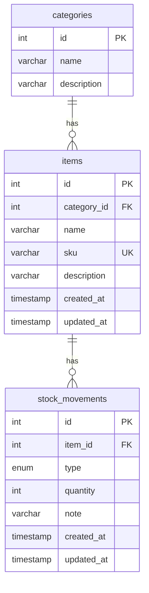
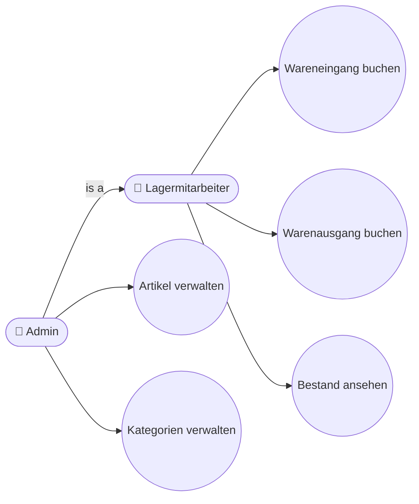
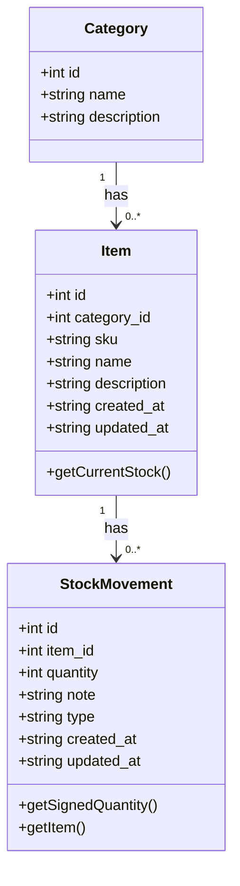
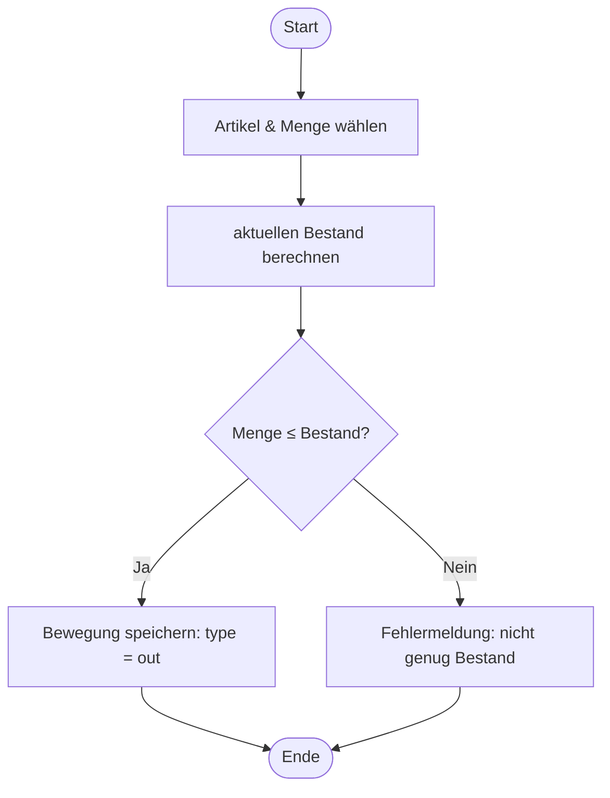

# Inventory Management — UML & Modellierung (Phase 4)

## 1. ER-Diagramm

Entspricht dem Schema in `db/schema.sql`.

## 2. Use Case Diagram

Zwei Akteure. **Admin** ist ein **Lagermitarbeiter** mit zusätzlichen Rechten
(Generalisierung), kann also alles vom Lagermitarbeiter plus Verwaltung.

## 3. Class Diagram (Domain Model)

## 4. Activity Diagram — „Warenausgang buchen"

Der Entscheidungspunkt `{Menge ≤ Bestand?}` ist die Business-Regel aus Phase 2
(kein negativer Bestand), hier im Ablauf sichtbar gemacht.

flowchart TD
    Start([Start]) --> A[Artikel & Menge wählen]
    A --> D{aktuellen Bestand berechnen} → {Menge ≤ Bestand?}
    D -->|Ja| B[Bewegung speichern: type = out]
    D -->|Nein| C[Fehlermeldung: nicht genug Bestand] → (zurück oder Ende)
    B --> Ende([Ende])
    C --> Ende
